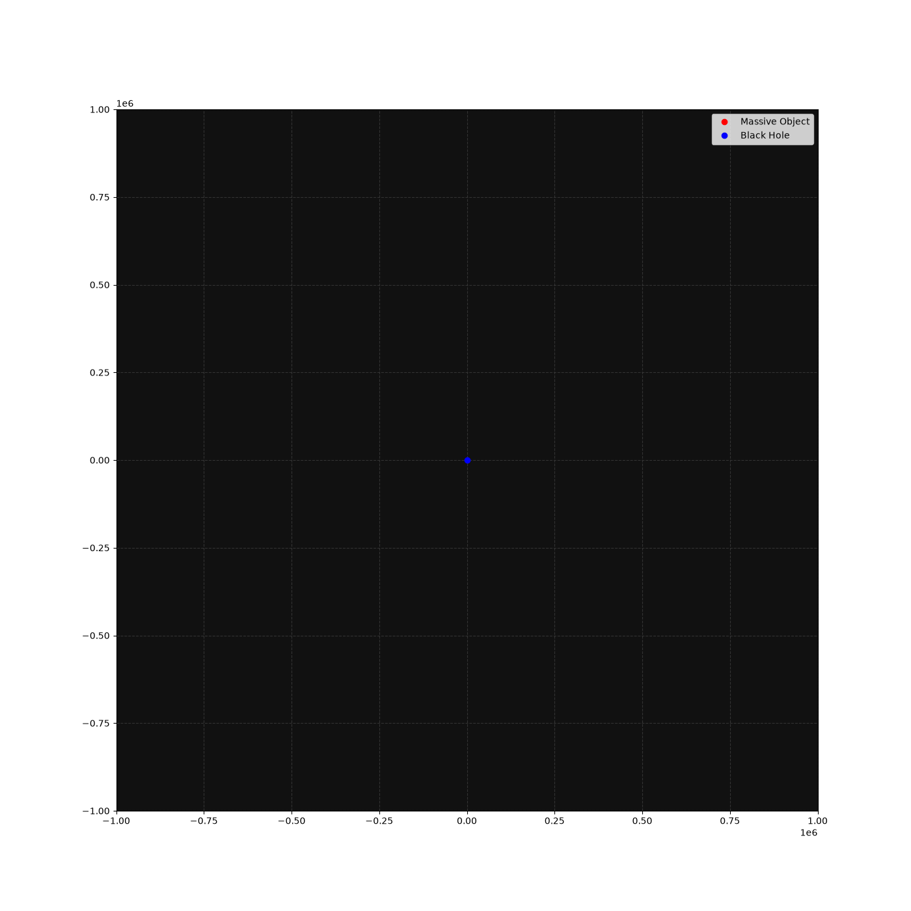

# General Relativistic Orbital Mechanics

This portfolio includes different orbital mechanics pushed to the extreme, where Newtonian approximations break down. These simulations were all theoretically derived by me before implemented.

-----

## Project 1: Relativistic Gravitational Whirling [10/21-10/25]


A model showcasing the relativistic result of scatter whirling when a massive object's impact parameter is just a hair's breadth from the critical impact parameter.

## Core Mechanics
* Utilizes conserved values - relativistic energy and angular momentum - to determine an object's radial and angular velocity
* Unlike previous projects, utilizes an adaptive time-stepping integrator to increase accuracy of model
* Effectively implements theory into code to accurately model whirling

-----

## How to Execute Pipelines
### 1. Relativistic Gravitational Whirling

```bash
g++ -o whirling_sim ./deep_space_whirling.cpp
./whirling_sim > deep_space_whirling.csv
python animate_deep_space_whirling.py
```
